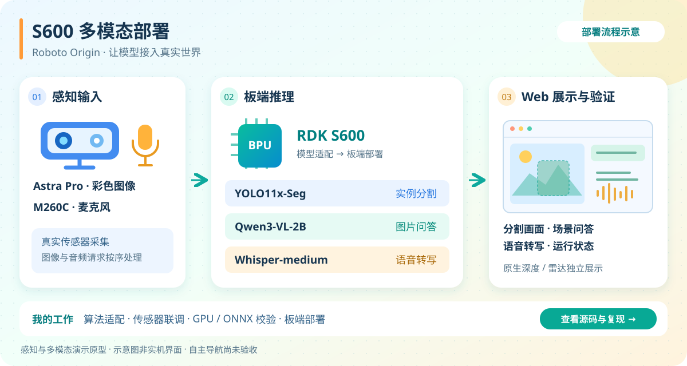

# 周苓萱 · CanNyCat

**重庆邮电大学 · 2028 届本科｜嵌入式 Linux · 端侧 AI · 机器人软件**

目前在 **地瓜机器人（D-Robotics）开发者生态部**担任 RDK 生态开发实习生（2026.08–至今）。我主要做模型适配与板端部署、机器人软件开发和实机联调，项目经历覆盖轻量模型训练、传感器与执行器接入、可视化工具及工程验证。

**工程类全国竞赛：一等奖 1 项、二等奖 2 项、三等奖 1 项；4 个工程项目担任队长。**

[机器鸭实机项目](https://github.com/Xiaomiju-x/rdk-x5-microduck) · [S600 多模态部署](https://github.com/Xiaomiju-x/roboto-origin-rdk-x5-s100/tree/main/apps/s600_coprocessor) · [工程竞赛项目](#工程竞赛项目) · [物理竞赛金奖作品](https://github.com/Xiaomiju-x/sasando-digital-resonator)

## 实习代表项目

### [RDK X5 MicroDuck｜机器鸭复刻与实机适配](https://github.com/Xiaomiju-x/rdk-x5-microduck)

以 [Pollen Robotics 开源 MicroDuck](https://github.com/pollen-robotics/microduck) 为原型，复用[社区飞特版机械结构](https://github.com/fanhao375/microduck-replica-cad)。在团队支持下，我主导 RDK X5 + HD1910M 方案选型、整机装配、软件控制与实机验证。

*点击实拍查看全机载短距离前进视频（2026-10-23）。*

- **整机与链路**：完成 15 舵机装配、关节映射、总线与 IMU 联调，以及 X5 CPU 策略推理验证。
- **软件与排障**：开发可视化调参、运行记录、安全复位与颈部控制，结合关节回读和姿态日志排查供电及执行器跟随问题。
- **实机成果**：X5、驱动板和电池全部上身后实现短距离前进，公开控制代码、参数与复盘。当前使用策略目标片段与分阶段颈部控制，实时策略行走及重复起停稳定性仍在验证。

同项目副线：**陆吾 XGO-Duck** 完成 15 轴标定及官方策略短程行走复现，直线保持继续验证；**南瓜鸭**完成 Web / UE5 等仿真展示，实体互动继续联调。V2 推进机内电控与电源集成。

[实拍与三线进展](https://github.com/Xiaomiju-x/rdk-x5-microduck/tree/main/progress/2026-10-23) · [控制模块](https://github.com/Xiaomiju-x/rdk-x5-microduck/tree/main/progress/2026-10-23/control) · [工程复盘](https://github.com/Xiaomiju-x/rdk-x5-microduck/blob/main/PITFALLS.md) · [地瓜社区记录](https://forum.d-robotics.cc/t/topic/35728)

### [Roboto Origin｜RDK X5 / S100 / S600 算法适配](https://github.com/Xiaomiju-x/roboto-origin-rdk-x5-s100)

负责公司团队项目中的算法适配、部署与验证。在团队已有的 X5 行走、舞蹈底座上，使用 S600 承担高层感知与多模态推理。

*部署流程示意，点击查看源码与复现说明。*

- **传感器联调**：接入深度相机、雷达与麦克风；两分钟真实相机分割演示约 **19.2 FPS**。
- **S600 部署**：在 BPU 跑通 YOLO11x-Seg、Qwen3-VL-2B 和 Whisper-medium，交付网页演示与部署文档；完成 X5/S100 离线适配。
- **开发验证**：使用 RTX 5090 完成 CUDA 浮点推理、ONNX 导出与数值校验，在线演示在 S600 执行。

当前公开成果为感知与多模态外挂原型；几何融合、现场语音准确率及自主导航尚未完成验收。

[S600 源码与复现](https://github.com/Xiaomiju-x/roboto-origin-rdk-x5-s100/tree/main/apps/s600_coprocessor) · [阶段结果与验证范围](https://github.com/Xiaomiju-x/roboto-origin-rdk-x5-s100/blob/main/docs/S600_COPROCESSOR_DEMO.md)

### 开发者生态交付

- **[课程与样例](https://github.com/D-Robotics/rdk-course-demos)**：交付显示、GPIO/PWM、UART/I²C、SPI、CAN 双语课程和实板演示，新增 10 条中英文成片并贡献组织仓库。[CAN 课程贡献](https://github.com/D-Robotics/rdk-course-demos/commit/0ce864e93e8eaed061cebff69023e732961ea03e)
- **生态技术支持**：复现相机、多媒体、BPU 并发和 MCU 接口问题，分析启动与显示日志，提供公开诊断建议及研发转交依据。代表答复：[BPU 并发](https://forum.d-robotics.cc/t/topic/35643/6)、[NAND 启动参数排查](https://forum.d-robotics.cc/t/topic/35730/22)。

## 竞赛与研究项目

### 工程竞赛项目

| 项目与实现 | 我的职责 | 竞赛成果 |
| --- | --- | --- |
| [双 RDK X5 材料 AI 与具身实验助理机器人](https://github.com/Xiaomiju-x/dual-rdk-x5-materials-ai-robot-lab) 材料分析、CPU/BPU 分层部署、多机与双机械臂联调 | 队长；端侧 AI 与机器人软件负责人 | 2026 嵌入式芯片与系统设计竞赛全国二等奖 |
| [RootScope｜RDK X5 根区灌溉舱](https://github.com/Xiaomiju-x/RootScope-AdventureX2026) 视觉判定与 X5→STM32→探针/水泵控制 | 队长；视觉与控制闭环负责人 | AdventureX 2026 地瓜机器人二等奖（第 2 名）、superun.ai 三等奖 |
| [Lab-Sentinel｜GD32H759 烧结安全哨兵](https://github.com/Xiaomiju-x/Lab-Sentinel-CIMC2026) 无 NPU MCU 上的边缘 AI、FreeRTOS/LVGL 与推理优化 | 队长；嵌入式软件与边缘 AI 负责人 | 2026 西门子杯全国二等奖 |
| [Memory ATE/PAT Platform｜存储芯片测试平台](https://github.com/Xiaomiju-x/memory-ate-pat-platform) I²C/SPI 测试向量、Electron 工具与大规模 PAT 流式生成 | 软件与 PAT 算法负责人 | 2026 集创赛全国一等奖 |
| [自主散料搬运机器人](https://github.com/Xiaomiju-x/intelligent-vision-logistics-crane-2026) Jetson 视觉模型训练与部署、ROS 2 导航及通信联调 | 队长；视觉与导航软件负责人 | 2026 物流技术创意赛全国三等奖 |

### [Sasando 数字谐振器｜国际大学生物理竞赛金奖](https://github.com/Xiaomiju-x/sasando-digital-resonator)

**2025 University Physics Competition · Gold Medal**

项目负责人 · Team 112 · Problem A

围绕电声 Sasando 的传统音色恢复，开展声学建模与参数化 IIR 数字滤波设计，采用 SOS 级联结构实现滤波器，完成频率响应、冲激响应与稳定性分析。公开 MATLAB/Python 实现与竞赛论文，展示从物理问题建模、数值分析到算法实现的过程。

[源码与文档](https://github.com/Xiaomiju-x/sasando-digital-resonator) · [官方金奖记录](https://www.uphysicsc.com/2025contest.html) · [官方获奖论文](https://www.uphysicsc.com/2025-GM-A-112.pdf)

## 技术栈

- **软件与系统**：C/C++、Python、Bash、Linux、Git、Docker。
- **端侧 AI**：PyTorch、ONNX Runtime、OpenCV、OpenExplorer；RDK X5/S100/S600 CPU/BPU 模型适配、量化与部署，Jetson 视觉应用。
- **机器人与嵌入式**：ROS 2、Nav2/SLAM；STM32/GD32、FreeRTOS/LVGL；I²C、SPI、UART、CAN 与传感器/执行器联调。
- **建模与验证**：MATLAB/Python 信号处理、MuJoCo 仿真、轻量模型训练与微调、数值对照和实机性能分析。

## 交流与合作

欢迎交流机器人、端侧 AI、嵌入式 Linux、数字信号处理，以及相关竞赛与实习机会。我更熟悉模型适配、板端部署和实机联调，也可以承担轻量训练、仿真验证与工程工具开发，期待与算法、硬件和机械方向的伙伴合作。

邮箱：[3773318175@qq.com](mailto:3773318175@qq.com)。项目技术问题也欢迎在对应仓库提出 Issue。

## 其他探索

RDK Frontier Lab · 首版完成，当前未持续维护

[RDK Frontier Lab](https://github.com/Xiaomiju-x/rdk-frontier-lab) 是基于公司 RTX 5090、RDK S600/S100/X5 和官方模型开展的个人扩展部署探索，独立于主要实习交付。公开首版包含 CLI、数据与结果约定、测试和跨平台 CI，保留历史研究快照。[v0.1.0 发布记录](https://github.com/Xiaomiju-x/rdk-frontier-lab/releases/tag/v0.1.0)

---

主页整理于 2026-10-24；项目最新进展、来源与验证范围见各仓库。

