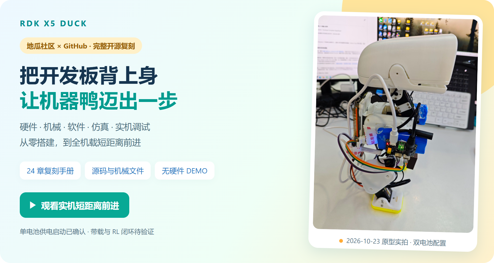

# 周苓萱 · CanNyCat

**机器人软件 · 端侧 AI · 嵌入式 Linux**

我把模型部署到开发板，接入传感器和执行器，通过实机调试完成工程验证，并将过程整理为可复现的软件与文档。

重庆邮电大学 · 集成电路设计与集成系统 · **2028 届本科** 
地瓜机器人（D-Robotics）开发者生态部 · **RDK 生态开发实习生** · 2026.08–至今

**工程类全国竞赛：一等奖 1 项、二等奖 2 项、三等奖 1 项；4 个工程项目担任队长。**

**[代表作品](#实习代表项目)　·　[工程竞赛](#工程竞赛项目)　·　[技术与代码](#技术与代码)　·　[项目合作](#项目合作)　·　[实习招聘与简历](#实习招聘与简历)**

欢迎机器人与嵌入式项目合作，以及相关实习机会。联系：[3773318175@qq.com](mailto:3773318175@qq.com)。

## 实习代表项目

### [RDK X5 Duck｜从开源结构到机载原型](https://github.com/Xiaomiju-x/rdk-x5-microduck)

将 RDK X5 接入开源机器鸭本体，完成机载控制、短距离前进验证与完整复刻资料交付。

- **我的贡献**：在团队支持下主导方案选型、15 轴装配与映射、Linux/Python 控制、总线与 IMU 联调；开发 Web 调参、运行记录与颈部控制。
- **已交付**：双电池样机全机载短距离前进；地瓜社区与 GitHub 同步六篇 **24 章复刻手册**、公开软件、机械文件及 MuJoCo 教学仿真。
- **验证范围**：成功动作采用相对目标序列与分阶段颈部控制；单电池已验证供电启动，带载、连续运行与 RL 闭环继续推进。

[观看实机演示](https://github.com/Xiaomiju-x/rdk-x5-microduck/blob/main/media/20261023/onboard-short-walk.mp4) · [软件与 DEMO](https://github.com/Xiaomiju-x/rdk-x5-microduck/tree/main/software) · [24 章复刻手册](https://github.com/Xiaomiju-x/rdk-x5-microduck/blob/main/docs/FULL_SOLUTION.md) · [地瓜社区](https://forum.d-robotics.cc/t/topic/35728/1)

**[南瓜鸭 · Pumpkin Duck Garden｜已结项归档](https://github.com/Xiaomiju-x/rdk-x5-microduck/tree/main/projects/pumpkin-duck)**

万圣节外观与互动副线，已于 **2026-10-30 结项**。保留白色南瓜面具、打印瓜园、Web / UE5 展示和活动资料。面具承担角色外观，并预留相机、灯眼和声音接口；**视觉/语音软件与瓜园完整实物联动未完成**。相关用途与互动方案仅作拓展设计留档，不再主动推进。

[结项与实拍](https://github.com/Xiaomiju-x/rdk-x5-microduck/tree/main/projects/pumpkin-duck) · [面具结构快照](https://github.com/Xiaomiju-x/rdk-x5-microduck/tree/main/projects/pumpkin-duck/mechanical/mask) · [保留的未完成拓展](https://github.com/Xiaomiju-x/rdk-x5-microduck/blob/main/projects/pumpkin-duck/EXTENSIONS.md)

上游来源、同项目副线与后续进展

基于 [Pollen Robotics MicroDuck](https://github.com/pollen-robotics/microduck) 与[社区飞特版机械结构](https://github.com/fanhao375/microduck-replica-cad)。公开运行包支持 1/2/3/5 轮，已完成离线验证，多轮实机效果待验证。

同项目副线：**陆吾 XGO-Duck** 完成 15 轴标定与官方策略短程行走复现，直线保持继续验证；**南瓜鸭**已结项，面具用途与瓜园互动的未完成部分按上方档案保留，不再联调。主线推进 R9 实配、单电池带载与线束优化。

[固定版本下载](https://github.com/Xiaomiju-x/rdk-x5-microduck/releases/tag/v2026.10.27.1) · [单电池与 R9 进展](https://github.com/Xiaomiju-x/rdk-x5-microduck/blob/main/docs/SINGLE_POWER_R9.md)

### [Roboto Origin｜S600 多模态感知与板端部署](https://github.com/Xiaomiju-x/roboto-origin-rdk-x5-s100)

在公司团队已有的 X5 行走、舞蹈底座上，使用 S600 承担高层感知与多模态推理；我负责算法适配、部署与验证。

- **我的贡献**：接入深度相机、雷达与麦克风，完成 CUDA 浮点推理、ONNX 导出与数值校验，以及 S600 BPU 部署和 X5/S100 离线适配。
- **已交付**：YOLO11x-Seg、Qwen3-VL-2B、Whisper-medium 板端演示与文档；两分钟真实相机分割演示约 **19.2 FPS**。
- **验证范围**：感知与多模态外挂原型；几何融合、现场语音准确率及自主导航尚未完成验收。

[S600 源码与复现](https://github.com/Xiaomiju-x/roboto-origin-rdk-x5-s100/tree/main/apps/s600_coprocessor) · [阶段结果与验证范围](https://github.com/Xiaomiju-x/roboto-origin-rdk-x5-s100/blob/main/docs/S600_COPROCESSOR_DEMO.md)

## 竞赛与研究项目

### 工程竞赛项目

| 项目与个人开发内容 | 我的职责 | 竞赛成果 |
| --- | --- | --- |
| [双 RDK X5 材料 AI 与具身实验助理机器人](https://github.com/Xiaomiju-x/dual-rdk-x5-materials-ai-robot-lab) 开发材料分析链，完成 CPU/BPU 按需换模与多机双臂联调 | 队长；端侧 AI 与机器人软件负责人 | 2026 嵌入式芯片与系统设计竞赛全国二等奖 |
| [RootScope｜RDK X5 根区灌溉舱](https://github.com/Xiaomiju-x/RootScope-AdventureX2026) 部署视觉模型，联调 X5→STM32→探针/水泵控制 | 队长；视觉与控制闭环负责人 | AdventureX 2026 地瓜机器人二等奖（第 2 名）、superun.ai 三等奖 |
| [Lab-Sentinel｜GD32H759 烧结安全哨兵](https://github.com/Xiaomiju-x/Lab-Sentinel-CIMC2026) 开发 FreeRTOS/LVGL 固件与 HMI，优化 MCU 推理性能 | 队长；嵌入式软件与边缘 AI 负责人 | 2026 西门子杯全国二等奖 |
| [Memory ATE/PAT Platform｜存储芯片测试平台](https://github.com/Xiaomiju-x/memory-ate-pat-platform) 开发 I²C/SPI 向量算法、Electron 工具与 PAT 流式生成 | 软件与 PAT 算法负责人 | 2026 集创赛全国一等奖 |
| [自主散料搬运机器人](https://github.com/Xiaomiju-x/intelligent-vision-logistics-crane-2026) 视觉模型训练与 Jetson 部署、ROS 2 导航及串口桥开发 | 队长；视觉与导航软件负责人 | 2026 物流技术创意赛全国三等奖 |

### [Sasando 数字谐振器｜国际大学生物理竞赛金奖](https://github.com/Xiaomiju-x/sasando-digital-resonator)

**2025 University Physics Competition · Gold Medal**

项目负责人 · Team 112 · Problem A

围绕电声 Sasando 的传统音色恢复，开展声学建模与参数化 IIR 数字滤波设计，采用 SOS 级联结构实现滤波器，完成频率响应、冲激响应与稳定性分析。公开 MATLAB/Python 实现与竞赛论文，展示从物理问题建模、数值分析到算法实现的过程。

[源码与文档](https://github.com/Xiaomiju-x/sasando-digital-resonator) · [官方金奖记录](https://www.uphysicsc.com/2025contest.html) · [官方获奖论文](https://www.uphysicsc.com/2025-GM-A-112.pdf)

## 技术与代码

按技术方向查看我的实现与验证记录：

| 技术方向 | 可查看的代码与证据 |
| --- | --- |
| Linux 设备接入、串口与执行器联调 | 机器鸭 [控制软件](https://github.com/Xiaomiju-x/rdk-x5-microduck/tree/main/software) · [排障复盘](https://github.com/Xiaomiju-x/rdk-x5-microduck/blob/main/PITFALLS.md) |
| 模型适配、数值校验与 BPU 部署 | S600 [应用源码](https://github.com/Xiaomiju-x/roboto-origin-rdk-x5-s100/tree/main/apps/s600_coprocessor) · [验证报告](https://github.com/Xiaomiju-x/roboto-origin-rdk-x5-s100/blob/main/docs/S600_COPROCESSOR_DEMO.md) |
| ROS 2、多机协同与机器人集成 | 双 X5 [具身软件](https://github.com/Xiaomiju-x/dual-rdk-x5-materials-ai-robot-lab/tree/main/embodied_brain) · [工程证据](https://github.com/Xiaomiju-x/dual-rdk-x5-materials-ai-robot-lab/tree/main/evidence) |
| MCU 固件、实时系统与边缘推理 | Lab-Sentinel [固件](https://github.com/Xiaomiju-x/Lab-Sentinel-CIMC2026/tree/main/firmware) · [AI 模块](https://github.com/Xiaomiju-x/Lab-Sentinel-CIMC2026/tree/main/ai) |
| 协议、PAT 算法与桌面工具 | ATE/PAT [生成器](https://github.com/Xiaomiju-x/memory-ate-pat-platform/blob/main/at24c02_pat_generator.py) · [决赛平台](https://github.com/Xiaomiju-x/memory-ate-pat-platform/tree/main/national-final) |

常用技术栈

- **软件与系统**：C/C++、Python、Bash、Linux、Git、Docker。
- **端侧 AI**：PyTorch、ONNX Runtime、OpenCV、OpenExplorer；RDK X5/S100/S600 CPU/BPU 模型适配、量化与部署，Jetson 视觉应用。
- **机器人与嵌入式**：ROS 2、Nav2/SLAM；STM32/GD32、FreeRTOS/LVGL；I²C、SPI、UART、CAN 与传感器/执行器联调。
- **建模与验证**：MATLAB/Python 信号处理、MuJoCo 仿真、轻量模型训练与微调、数值对照和实机性能分析。

## 开源与开发者生态

- **课程与样例**：交付显示、GPIO/PWM、UART/I²C、SPI、CAN 双语课程和实板演示，其中 S100 第 11–13 课与 X5/S100 CAN 合计 10 条中英文成片。[组织仓库](https://github.com/D-Robotics/rdk-course-demos) · [CAN 课程贡献](https://github.com/D-Robotics/rdk-course-demos/commit/0ce864e93e8eaed061cebff69023e732961ea03e)
- **生态技术支持**：复现设备与推理问题，分析日志，提供公开诊断建议及研发转交依据。[BPU 并发答复](https://forum.d-robotics.cc/t/topic/35643/6) · [NAND 启动排查](https://forum.d-robotics.cc/t/topic/35730/22)

## 项目合作

欢迎机器人、端侧 AI 与嵌入式方向的开源共建、竞赛组队和项目合作。

**我可以承担**：机器人软件、模型适配与板端部署、传感器／执行器联调、可视化工具和复现文档；也有轻量训练与仿真验证经历。 
**期待互补伙伴**：机械结构、硬件电控、运动控制与算法方向。

[邮件交流合作](mailto:3773318175@qq.com?subject=项目合作交流)时，欢迎附上项目目标、已有进展和希望我承担的部分。具体复刻问题与改进建议可在对应项目仓库提出 Issue。

## 实习招聘与简历

**2028 届本科｜关注嵌入式 Linux、端侧 AI 部署、机器人软件相关实习与招聘机会。**

可从上方[技术与代码](#技术与代码)按岗位方向查看实现；面试中可以围绕方案取舍、模型校验、通信与实机排障、复现交付展开交流。

**[索取最新简历／沟通岗位](mailto:3773318175@qq.com?subject=实习招聘与简历沟通)** · 3773318175@qq.com 
欢迎附上岗位描述、团队方向与预期安排，具体实习时间和地点通过邮件沟通。

## 其他探索

RDK Frontier Lab · 首版完成，当前未持续维护

[RDK Frontier Lab](https://github.com/Xiaomiju-x/rdk-frontier-lab) 是基于公司 RTX 5090、RDK S600/S100/X5 和官方模型开展的个人扩展部署探索，独立于主要实习交付。公开首版包含 CLI、数据与结果约定、测试和跨平台 CI，保留历史研究快照。[v0.1.0 发布记录](https://github.com/Xiaomiju-x/rdk-frontier-lab/releases/tag/v0.1.0)

---

主页整理于 2026-10-30（本次更新南瓜鸭结项部分）；项目最新进展、来源与验证范围见各仓库。

